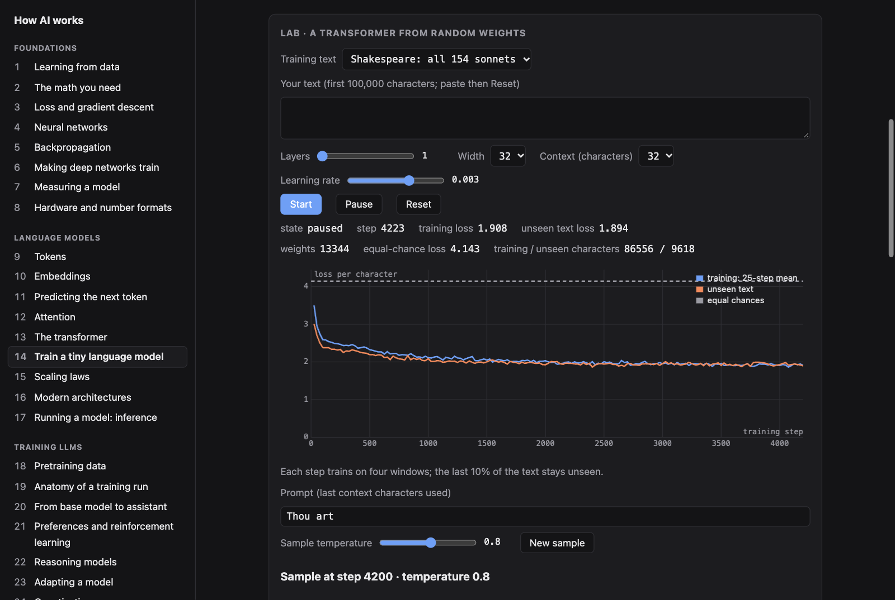

# How AI works

A short, hands-on course on how modern AI works, from fitting a curve to training, serving, and deploying large language models. 35 lessons, each a 2-minute read plus a lab that runs real computation in your browser: networks train, samplers sample, quantizers round. No accounts, no servers, no API keys.

**Live: https://ilm-alan.github.io/how-ai-works/**



## What's inside

| Part | Lessons |
|---|---|
| Foundations | Learning from data · The math you need · Gradient descent · Neural networks · Backpropagation · Making deep networks train · Measuring a model · Hardware and number formats |
| Language models | Tokens · Embeddings · Next-token prediction · Attention · The transformer · Train a tiny language model · Scaling laws · Modern architectures · Inference |
| Training LLMs | Pretraining data · Anatomy of a training run · From base model to assistant · Preferences and RL · Reasoning models · Adapting a model · Quantization |
| Building with models | Prompts and context · Search and RAG · Tools and structured output · Agents · Safety and security · Multimodal input · Diffusion |
| Evaluating and understanding | Evaluating LLMs · Looking inside · Shipping an AI feature · The field in 2026 |

Facts about specific models, prices, benchmarks, and regulation are current as of October 2026 and link to their sources at the bottom of each lesson.

## Run locally

Requires [Bun](https://bun.sh) 1.3+.

```sh
bun install
bun run dev      # http://localhost:4400 with hot reload (PORT=… to override)
bun run build    # static site in dist/
bun run check    # typecheck + tests
```

## Layout

```
server.ts                 dev server
src/main.ts               shell: sidebar, routing (#/slug), markdown + math, quizzes, progress (localStorage)
src/lessons/index.ts      lesson order
src/lessons/NN-slug/
  index.ts                title, quiz, sources
  lesson.md               text; a paragraph containing only {{lab}} marks where the lab goes
  lab.ts                  mount(root) → optional cleanup
  *.ts / *.test.ts        the math behind the lab, with tests
src/ui/                   controls and canvas charts
src/lib/tensor.ts         small autograd engine (Float32Array) with AdamW/SGD
```

To add a lesson, create a folder like the ones above and add it to `src/lessons/index.ts`. Labs compute everything live from seeded random numbers or embedded data. Put non-trivial math in its own module with a test.

## Contributing

Corrections are welcome, especially to dated facts. Please include a source. Keep lessons short and plain: explain an idea in everyday words, then name it.

## License

MIT. The embedded texts (Shakespeare's sonnets, *Alice's Adventures in Wonderland*) are public domain, from Project Gutenberg.
